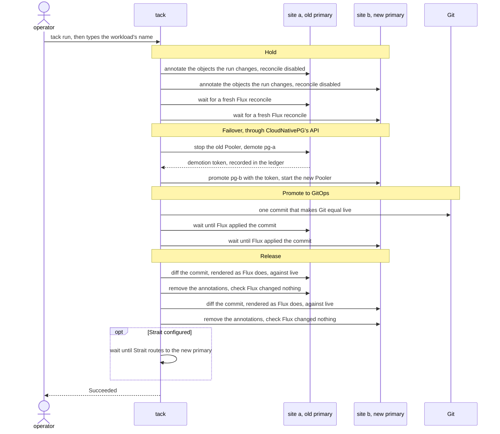
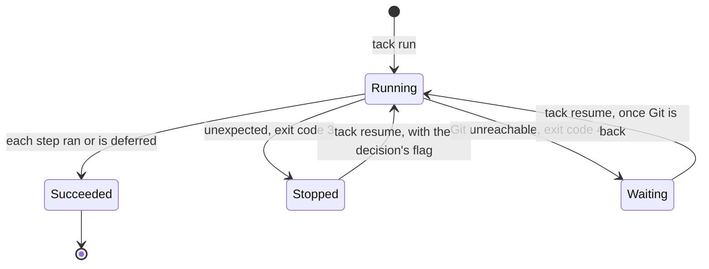

# Tack

Tack moves the primary of a CloudNativePG database from one Kubernetes site to another, when Flux deploys both sites from Git. It handles a planned switchover, and a failover after a site is lost. It changes the database only through CloudNativePG's own API, keeps Git in step, and records every step in a ledger, the `SiteFailover` resource.

The operator starts every run. Tack never decides to fail over by itself.

## Why

Moving the primary by hand fails in two ways:

| What goes wrong | What Tack does |
|---|---|
| Flux applies the old values from Git and reverts the switch. | Stops Flux from applying only the objects it changes, commits the new values to Git, and lets Flux apply them again once Git equals live. |
| The demotion token must travel from the old primary's cluster to the new one between two steps. Promoting without it can fork the data. | Waits for the old primary to publish the token, records it in the ledger, and promotes the new primary with it. |

[RFC#0001](rfcs/RFC0001.md) gives the full scope.

## How a run works

A run has four phases. Each step is written to the ledger before it starts and after it ends.

A planned run from site a to site b:



| Phase | Tack does |
|---|---|
| Hold | Annotates only the live objects the run changes with `kustomize.toolkit.fluxcd.io/reconcile: disabled`, then waits for a fresh Flux reconcile. Flux stops applying them. |
| Failover | Changes those objects through CloudNativePG's API, in order, and waits for each result. In a planned run: stop the old Pooler, demote the old primary, capture its demotion token, promote the new primary with it, start the new Pooler. |
| Promote to GitOps | Writes one commit that makes Git equal live, on top of the revision live matched at Hold, and waits until Flux at each site has applied it. |
| Release | Renders the commit as Flux does and diffs it against live. Removes the annotations only if they match, then checks that Flux changed nothing. With Strait configured, waits until Strait routes to the new primary. |

The ledger is a `SiteFailover` object at the new primary's site, in the namespace `tack-system` by default. Its `spec` holds the whole plan and never changes; its `status` holds every step's result, the demotion token, the held objects and the Git commit. `tack status` reads it, and so does `kubectl --context site-b -n tack-system get sitefailovers` (short name `sfo`).

A run is in one of four states, recorded in the ledger:



| Mode | When | What happens |
|---|---|---|
| `--mode planned` (default) | Both sites answer. | The old primary demotes and hands its token to the new one. No write is lost. |
| `--mode site-loss` | The old site is lost. Confirm it first: [runbook](docs/runbooks/site-loss.md). | The new site promotes without a token. The old primary needs a rebuild before it can follow again: [runbook](docs/runbooks/rebuild-old-primary.md). |

## Safety

| Property | How |
|---|---|
| The operator starts every run | Only `tack run` starts a run. Tack has no timer, watch or health check that starts one. |
| Plan first | `tack plan` reads every site and Git, prints every step, patch, wait, Git edit and check, and changes nothing. |
| Typed confirmation | `tack run` and `tack resume` print the plan or the ledger, then ask the operator to type the workload's name. Without a terminal they refuse, unless `--yes` is given for a run a human approved. |
| Narrow hold | Only the objects the run changes are held, on the live objects. No Kustomization is suspended, and nothing is annotated in Git. |
| Resume from the ledger | The plan is stored in the ledger when the run starts. `tack resume` continues that plan and never plans again. Every step is safe to repeat. |
| Git equals live before release | Tack releases an object only after the run's commit, rendered as Flux renders it, matches live. After release it checks that Flux changed nothing. |
| Stop and ask | Anything unexpected stops the run with a reason in the ledger and exit code 3: Git changed during the run, a token is missing, a lost site came back as primary, an object is held by someone else. |
| Break-glass | In a site loss with Git down, Tack still switches live, then waits at the Git step with exit code 4. `tack resume` commits once Git is back. Nothing is released before that. |
| Explicit contexts | Each site uses the kube context named in the Workload file. Tack never falls back to the current context. |
| AI agents | `tack --help` and `tack --skill` tell agents never to start `tack run` or `tack resume` without a human's explicit instruction for that run, and to run `tack plan` first. |
| No secrets | Git access comes from the operator's own `git` configuration. The ledger holds no secret, and `tack status` prints captured values by name only. |

## What v1 supports

| Area | Support |
|---|---|
| Workload | CloudNativePG in the distributed topology: one `Cluster` per site, the primary named by `.spec.replica.primary`, and an optional read-write `Pooler` per site. Driver `cnpg`. |
| GitOps | Flux kustomize-controller with a `GitRepository` source, one Git repository for all sites. |
| Routing check | Optional. Reads the `SiteService` status of [Strait](https://github.com/takodotid/strait) v1.0.0 or later, which routes clients to the primary. |
| Platforms | Linux, macOS and Windows, amd64 and arm64. |
| Tested with | CloudNativePG v1.30.1, Flux v2.10.0 and Kubernetes v1.37, in the end-to-end test. |

## Status

The latest release is v1.3.1. The API is `failover.tako.id/v1`, for both the `SiteFailover` ledger and the Workload file. A change that would break a user comes as a new API version. `failover.tako.id/v1alpha1`, the API of v0.1.x, is deprecated and still served: see [Upgrading from v0.1.x](#upgrading-from-v01x).

## Install

Each release on the [releases page](https://github.com/takodotid/tack/releases) has an archive per platform, `SHA256SUMS`, the CRD, and a Helm chart of the CRD and of optional roles. Each archive holds `tack`, its man pages and the CRD. The chart is also published at `oci://ghcr.io/takodotid/charts/tack`. From v1.3.0, a release also has an SBOM per archive, and signatures and attestations for every asset: see [Verify a release](#verify-a-release).

```sh
VERSION=v1.3.1
OS=linux      # or darwin
ARCH=amd64    # or arm64
NAME=tack-$VERSION-$OS-$ARCH
curl -fsSLO https://github.com/takodotid/tack/releases/download/$VERSION/$NAME.tar.gz
curl -fsSLO https://github.com/takodotid/tack/releases/download/$VERSION/SHA256SUMS
grep " $NAME.tar.gz\$" SHA256SUMS | sha256sum -c -    # on macOS: shasum -a 256 -c -
# Then check the signature of SHA256SUMS: see Verify a release, below.
tar -xzf $NAME.tar.gz
sudo install -m 0755 $NAME/tack /usr/local/bin/tack
sudo mkdir -p /usr/local/share/man/man1
sudo cp $NAME/man/man1/*.1 /usr/local/share/man/man1/
```

On Windows the archive is a `.zip` with `tack.exe`. Install it in PowerShell:

```powershell
$VERSION = "v1.3.1"
$NAME = "tack-$VERSION-windows-amd64"    # or arm64
$URL = "https://github.com/takodotid/tack/releases/download/$VERSION"
Invoke-WebRequest "$URL/$NAME.zip" -OutFile "$NAME.zip" -UseBasicParsing
Invoke-WebRequest "$URL/SHA256SUMS" -OutFile SHA256SUMS -UseBasicParsing
$sum = (Get-Content SHA256SUMS | Where-Object { $_.EndsWith("  $NAME.zip") }).Split(" ")[0]
if ((Get-FileHash "$NAME.zip" -Algorithm SHA256).Hash -ne $sum) { throw "$NAME.zip does not match SHA256SUMS" }
Expand-Archive "$NAME.zip" -DestinationPath .
$bin = "$env:LOCALAPPDATA\Programs\tack"
New-Item -ItemType Directory -Force $bin | Out-Null
Copy-Item "$NAME\tack.exe" $bin
```

Add that folder to `Path` once, then open a new terminal.

| Difference on Windows | Detail |
|---|---|
| `KUBECONFIG` | Separates files with `;`, not `:`: see [docs/workload.md](docs/workload.md#every-sites-context-in-one-kubeconfig). |
| Man pages | Windows has no `man`. `tack --help` and `tack <command> --help` hold the same text. |
| Skill document | In Windows PowerShell 5.1, `tack --skill > SKILL.md` writes UTF-16LE, not the UTF-8 that `tack` prints. PowerShell 7 and `cmd.exe` keep UTF-8. |

To build from source instead: `make build` writes `bin/tack`.

At every site, install the CRD with the chart. The chart can also create the operators' roles, off by default: see [The chart's roles](docs/operations.md#the-charts-roles). Name the release's namespace after the ledger namespace, `spec.ledger.namespace` in the Workload file, so that `--create-namespace` creates it. Tack never creates the ledger namespace: without it, `tack run` fails at the ledger's create, before any step.

```sh
for ctx in site-a site-b; do
  helm --kube-context "$ctx" upgrade --install tack oci://ghcr.io/takodotid/charts/tack --version "${VERSION#v}" \
    --namespace tack-system --create-namespace
done
```

| Rule | Why |
|---|---|
| One release per cluster. | The CRD is cluster-scoped. A second release, under another name or in another namespace, fails with `invalid ownership metadata` and changes nothing. |
| One way per cluster: the chart, or `kubectl apply --server-side` of the CRD. | The chart refuses a CRD that kubectl applied, with `invalid ownership metadata`. To hand such a CRD to the chart, label it `app.kubernetes.io/managed-by=Helm`, annotate it `meta.helm.sh/release-name=tack` and `meta.helm.sh/release-namespace=tack-system`, then install. |
| Upgrade with the same command. | `helm upgrade` without values reuses the release's last values, `crds.keep` and `crds.install` included: `helm --kube-context "$ctx" -n tack-system get values tack` shows them. |
| Never set `crds.keep=false` while the site holds a ledger that matters: a run that is not `Succeeded`, or a `Rebuild` follow-up not yet done. | With `crds.keep=false`, `helm uninstall` deletes the CRD, and every ledger with it. So does an upgrade with `crds.install=false`. A lost `Rebuild` follow-up lets a planned run onto a member that diverged ([RFC#0003](rfcs/RFC0003.md#requirements), Requirement 14). The upgrade that sets `crds.keep=false` takes the keep policy off the CRD at once. |

`helm uninstall` with `crds.keep=true`, the default, leaves the CRD, every ledger and the namespace; installing again under the same release name and namespace takes the CRD back. Without Helm, apply the CRD instead: `kubectl --context "$ctx" apply --server-side -f $NAME/failover.tako.id_sitefailovers.yaml`, then create the ledger namespace.

Tack also needs:

| Need | Detail |
|---|---|
| A kube context per site | All in one kubeconfig (`--kubeconfig`, or the standard loading rules). To combine one file per cluster, see [docs/workload.md](docs/workload.md#every-sites-context-in-one-kubeconfig). The permissions are listed in [docs/operations.md](docs/operations.md#permissions). |
| Git access | Through the operator's `git` configuration, such as an SSH agent or a credential helper. Tack runs `git` with `GIT_TERMINAL_PROMPT=0` and stores no credential. The branch must accept a push from those credentials. |
| A Workload file | The sites, their contexts, the Git repository and where each field lives in it: [docs/workload.md](docs/workload.md). |

### Verify a release

From v1.3.0, each release signs `SHA256SUMS` and the chart with Sigstore, keyless, under the identity of its release workflow, and attests every asset with GitHub artifact attestations. No signing key exists. `make dist` at a release's tag, in a clean checkout with the Go version of `go.mod`, gives the same archives. Releases v1.2.1 and older carry no signature.

| Asset | Verify with |
|---|---|
| `SHA256SUMS`, and through it every asset | [cosign](https://docs.sigstore.dev/cosign/verifying/verify/) 3: `cosign verify-blob` with `SHA256SUMS.sigstore.json` |
| Any asset, one by one | the GitHub CLI: `gh attestation verify` |
| The chart at `oci://ghcr.io/takodotid/charts/tack` | `cosign verify` |
| `tack-$VERSION-<os>-<arch>.cdx.json` | the CycloneDX SBOM of that archive's binary, listed in `SHA256SUMS` |

In the folder of the download above, before `tar -xzf`:

```sh
id="https://github.com/takodotid/tack/.github/workflows/release.yaml@refs/tags/$VERSION"
issuer=https://token.actions.githubusercontent.com
curl -fsSLO https://github.com/takodotid/tack/releases/download/$VERSION/SHA256SUMS.sigstore.json
cosign verify-blob --bundle SHA256SUMS.sigstore.json --certificate-identity "$id" --certificate-oidc-issuer "$issuer" SHA256SUMS
gh attestation verify $NAME.tar.gz --repo takodotid/tack --cert-identity "$id"
cosign verify ghcr.io/takodotid/charts/tack:${VERSION#v} --certificate-identity "$id" --certificate-oidc-issuer "$issuer"
```

`cosign verify-blob` proves that the release workflow of the tag wrote `SHA256SUMS`; the `sha256sum -c` above then ties the archive to it.

## Upgrading within v1

Upgrade in this order:

1. **Finish or stop every run.** `tack status -f workload.yaml`, for each workload, lists every run `Succeeded`, or `Stopped` or `Waiting` with no `tack` process running it. A run that resumes after the upgrade runs its remaining steps by the new CLI's rules.
2. **The CRD at every site,** the way it was installed: the `helm upgrade --install` above, or `kubectl apply --server-side` of the new CRD. Do this before any operator runs the new CLI against the site. A CRD older than the CLI drops the fields it does not know, without an error: `tack run` refuses to create a ledger at such a site, and status writes there lose those fields.
3. **Every operator's CLI together,** and every script that runs `tack`. A CLI drops the status fields it does not know when it writes a ledger. From v1.3.0, each write records its CLI's version in `status.writtenBy`, and a CLI of an older release refuses to resume or abandon that run, and names the version to use ([RFC#0003](rfcs/RFC0003.md#requirements), Requirement 24). A CLI older than v1.3.0 does not check.

Each release also needs:

| From | To | CRD | Also before the new CLI runs |
|---|---|---|---|
| v1.3.0 | v1.3.1 | unchanged | A script that runs `tack status -f` gets exit code 1 when a site gives no answer, with the runs it read: the list is incomplete ([docs/operations.md](docs/operations.md#reading-a-run)). |
| v1.2.x | v1.3.0 | new optional fields: `spec.takeOvers`, `status.abandoned`, `status.git.changedRevision`, `status.history`, `status.historyDropped`, `status.writtenBy`; the column Reason in `kubectl get sfo` | Grant `create` on `events` in the ledger namespace, for the ledger's Events; without it, a run goes on without them ([docs/operations.md](docs/operations.md#permissions)). Quote every site name that YAML reads as a boolean or a number, such as `n`, `on` or `010`, in each Workload file: v1.3.0 refuses it unquoted ([docs/workload.md](docs/workload.md#specsites)). A run planned before recorded the decoded name, such as `false`, and its flags, such as `--fence`, take that name. |
| v1.2.0 | v1.2.1 | unchanged | nothing |
| v1.0.x or v1.1.x | v1.2.x | new optional fields: `spec.takeOver`, `spec.fingerprints`, `status.fingerprints`, `status.supersededBy`, `status.git.releaseRevision` | Grant `get` on the namespace `kube-system` at every site: the plan reads its UID to identify the site's cluster, and fails with `forbidden` without it. Move a user out of an `http` or `https` Git URL, such as `https://user@git.example.com/gitops.git`, into git's configuration (`credential.<url>.username`): Tack refuses such a URL. `ssh://git@git.example.com/gitops.git` and `git@git.example.com:gitops.git` still work. |

| A ledger written by | Under v1.2.1, v1.3.0 and v1.3.1 |
|---|---|
| v1.2.x | `tack resume` continues it. |
| v1.0.x or v1.1.x | `tack resume` continues it. Each site's cluster is recorded in `status.fingerprints` on its first read, and checked after. |

## Upgrading from v0.1.x

1. At every site, upgrade the CRD the way it was installed: the `helm upgrade --install` above, or `kubectl apply --server-side` of the new CRD. Do this before running tack v1.0.0 against the site: tack v1.0.0 reads ledgers as `v1`, and against a site still on the v0.1.x CRD it stops and says to upgrade the CRD.
2. Install tack v1.0.0 or later.
3. In each Workload file, set `apiVersion: failover.tako.id/v1`. Nothing else changes. Tack still reads `failover.tako.id/v1alpha1`, with a warning.

| After the upgrade | Behaviour |
|---|---|
| Ledgers written by v0.1.x | `tack status` reads them and `tack resume` continues them. The API server serves them as `v1` and stores each as `v1` the next time it is written. |
| tack v0.1.x | Still reads and writes ledgers, through `v1alpha1`, until every operator has upgraded. |
| `kubectl` | Warns on each `v1alpha1` request. Until its discovery cache refreshes, `kubectl get sfo` may still ask for `v1alpha1`. |
| Downgrading the CRD to v0.1.x | Refused by the API server: `v1` is now in the CRD's `status.storedVersions`. |

## Walkthrough

With the Workload file of [docs/workload.md](docs/workload.md), a planned switchover from site a to site b:

```sh
# Read every site and Git, print every step, change nothing.
tack plan -f workload.yaml --to b

# Print the plan again, ask for the workload's name, then run it.
tack run -f workload.yaml --to b

# List the workload's runs at every site, or show one run step by step.
tack status -f workload.yaml
tack status pg-main-20261027-101500 -f workload.yaml

# Continue a run that stopped (exit code 3) or waits (exit code 4).
tack resume pg-main-20261027-101500 -f workload.yaml
```

After a site loss, add `--mode site-loss` to `plan` and `run`. [docs/operations.md](docs/operations.md) covers stopped runs and break-glass.

An excerpt of `tack plan`:

```text
Plan for workload pg-main: Planned, site a to site b
Ledger: SiteFailover tack-system/pg-main-20261027-101500 at site b

Sites:
  a  Primary  declares a  healthy  Cluster db/pg-a: phase "Cluster in healthy state", declares pg-a primary, pod pg-a-1; Pooler pg-a-pooler-rw has 2 instances
  b  Replica  declares a  healthy  Cluster db/pg-b: phase "Cluster in healthy state", declares pg-a primary, pod pg-b-1; Pooler pg-b-pooler-rw has 0 instances
...
Failover
...
   9. demote-a  site a
      demote Cluster pg-a: declare pg-b primary and drop any old token
        patch Cluster db/pg-a (merge): {"spec":{"replica":{"primary":"pg-b","promotionToken":null}}}
  10. wait-demoted-a  site a
      wait until Cluster pg-a has demoted and published its demotion token
        wait up to 15m0s on Cluster db/pg-a until:
          {.status.demotionToken} is not empty
          {.status.switchReplicaClusterStatus.inProgress} NotEquals "true"
  11. capture-token  site a
      record the demotion token of Cluster pg-a in the ledger
        record {.status.demotionToken} of Cluster db/pg-a in the ledger as $(demotionToken)
  12. promote-b  site b
      promote Cluster pg-b with the demotion token, in one patch
        patch Cluster db/pg-b (merge): {"spec":{"replica":{"primary":"pg-b","promotionToken":"$(demotionToken)"}}}
...
PromoteToGitOps
  18. git-commit  Git
      commit the live state to ssh://***@git.example.com/gitops.git branch main
        clusters/site-a/db/cluster.yaml, document 0: spec.replica.primary = "pg-b"  (site a, Cluster db/pg-a spec.replica.primary)
        clusters/site-a/db/cluster.yaml, document 0: spec.replica.promotionToken removed  (site a, Cluster db/pg-a spec.replica.promotionToken)
        clusters/site-a/db/pooler.yaml, document 0: spec.instances = 0  (site a, Pooler db/pg-a-pooler-rw spec.instances)
        clusters/site-b/db/cluster.yaml, document 0: spec.replica.primary = "pg-b"  (site b, Cluster db/pg-b spec.replica.primary)
        clusters/site-b/db/cluster.yaml, document 0: spec.replica.promotionToken removed  (site b, Cluster db/pg-b spec.replica.promotionToken)
        clusters/site-b/db/pooler-instances.yaml: spec.instances = 2  (site b, Pooler db/pg-b-pooler-rw spec.instances)
        commit message: tack: pg-main primary a to b (planned)
...

Nothing was changed. To run this plan: tack run -f workload.yaml --to b --from a --mode planned
```

`tack --help` lists the exit codes. `tack <command> --help` and `man tack` document every command and flag.

## Quick start: the end-to-end test

The end-to-end test builds two kind clusters with Flux, CloudNativePG, Strait and a local Git server, then switches the primary between them.

| Needs | Version |
|---|---|
| Linux with Docker | Docker 29 or later |
| Go | as in `go.mod` |
| kind | v0.33.0 |
| kubectl | v1.37.1 |
| flux CLI | v2.10.0 exactly |
| helm | v4.3.1 |
| git, openssl, curl, sha256sum | any |
| Internet access | to pull images, and to fetch CloudNativePG's release manifest and Strait's source at the commit pinned in `test/e2e/env/lib.sh` |

`hack/tools/install.sh [DIR]` installs kind, kubectl, flux and helm at these versions into `DIR` (default `bin/tools`), and fails unless each download matches the SHA-256 pinned in the script; add `DIR` to `PATH`. It runs on Linux, amd64 or arm64.

```sh
make e2e
```

| Scenario | What it checks |
|---|---|
| Planned switchover | the token moves, no write is lost, Git equals live, Flux changes nothing after release |
| A blip during a plan | with one site's node paused for 10 s, the plan checks the site again, succeeds and notes the retry |
| Interrupted run | a run killed before its promotion, whose old primary was then promoted again by hand, stops before the promotion; the next run takes it over, is killed mid-step, and resumes from its ledger |
| Git changed during a run | the run stops; it goes on once the operator accepts the new head |
| Site loss with Git down | Tack switches live and waits for Git (break-glass) |
| A site coming back | a lost site that answers as primary stops the run until the operator fences it |
| Rebuild and switch back | a planned run to the failed-over site is refused until it is rebuilt; then it becomes primary again |
| Routing from Strait | with Strait running at both sites, a run ends once Strait routes to the new primary |

| Command | Effect |
|---|---|
| `TACK_E2E_KEEP=1 make e2e` | keeps the environment after the tests. Their Workload file is `.e2e/workload.yaml`: after `make build`, `bin/tack --kubeconfig .e2e/kubeconfig status -f .e2e/workload.yaml` lists their runs |
| `make e2e-up` | builds the environment and leaves it running |
| `make e2e-down` | removes it |

Everything the test creates is named `tack-e2e*`. [test/e2e/env/README.md](test/e2e/env/README.md) describes the environment.

## Documentation

| Doc | Content |
|---|---|
| [docs/workload.md](docs/workload.md) | every field of the Workload file, with a complete example |
| [docs/operations.md](docs/operations.md) | reading a run, the decision flags, break-glass, permissions |
| [docs/runbooks/site-loss.md](docs/runbooks/site-loss.md) | confirming a site loss and fencing the old primary before a site-loss run |
| [docs/runbooks/rebuild-old-primary.md](docs/runbooks/rebuild-old-primary.md) | rebuilding an old primary after a site loss |
| [docs/runbooks/stop-reasons.md](docs/runbooks/stop-reasons.md) | the way on for each reason a run stops or waits |
| [docs/runbooks/no-primary-after-demotion.md](docs/runbooks/no-primary-after-demotion.md) | a planned run that stopped between its demotion and its promotion |
| [docs/runbooks/abandon-run.md](docs/runbooks/abandon-run.md) | abandoning a run, and removing a hold left behind |
| [docs/runbooks/release.md](docs/runbooks/release.md) | publishing a release, and what to do when it stops |
| [SECURITY.md](SECURITY.md) | reporting a vulnerability, supported versions |
| [rfcs/](rfcs/) | the design, one subject per RFC |
| `tack --help`, `tack <command> --help`, `man tack` | every command, flag and exit code |
| `tack --skill` | the guide for AI agents |

## Contributing

- [AGENTS.md](AGENTS.md) holds the rules for every change, by a human or an agent.
- The design lives in [rfcs/](rfcs/). A design change starts as an RFC, `Draft` while under discussion, and becomes `Active` once the maintainers approve it. The code conforms to the Active RFCs; if they disagree, the RFC is amended first.
- Before a pull request: `make verify test lint`. For a change to how a run behaves, also `make e2e`.
- Commits follow conventional commits: `type(scope): subject`.

## License

Apache-2.0. See [LICENSE](LICENSE).
